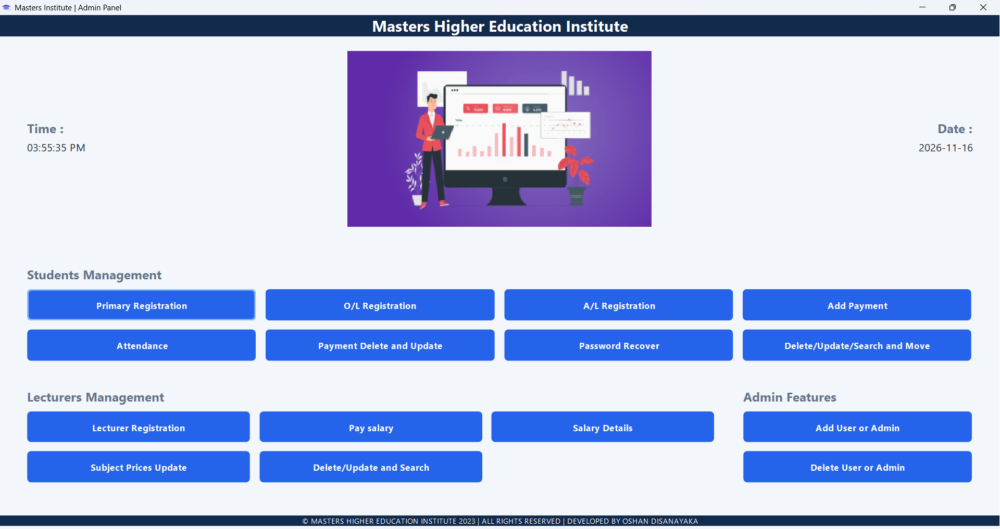
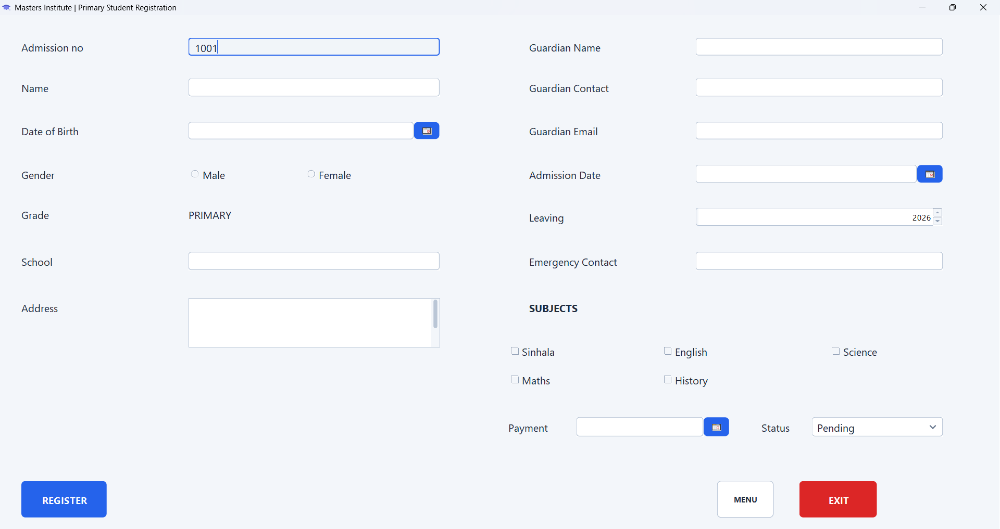
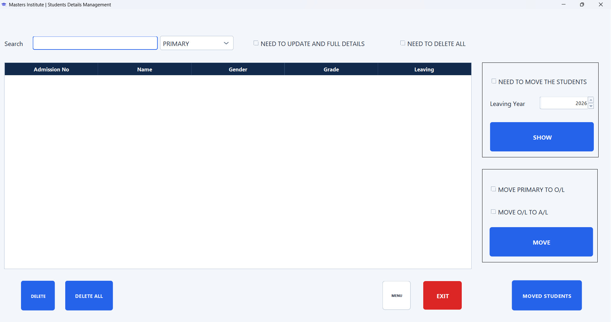
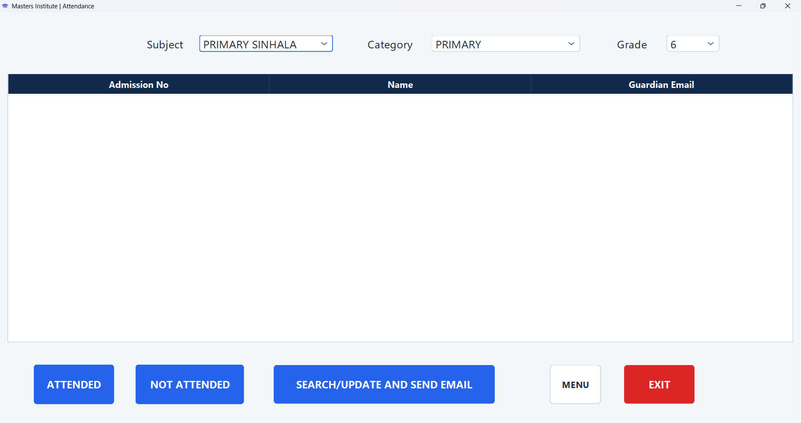

# Masters Institute Management System

A desktop management system for **Masters Higher Education Institute**, a private tuition institute in Sri Lanka. It handles student registration (Primary, O/L and A/L), fee payments, attendance with e-mail alerts to guardians, lecturer records and monthly salary calculation, all from one Java application.

Built as my **BSc in Information Technology final-year project** (American National College, Colombo) for a real client: the institute uses it to replace paper registers and spreadsheets.

   

---

## Screenshots

| Admin dashboard | Student registration |
|---|---|
|  |  |

| Student management | Attendance |
|---|---|
|  |  |

---

## Features

**Two roles**
- **Admin** – full access, including salaries, subject prices and user management.
- **User (office staff)** – day-to-day student, payment and attendance work.
- Separate login screens, password reset, and "forgot password" by e-mail.

**Students**
- Registration for three levels: **Primary**, **O/L** (Ordinary Level) and **A/L** (Advanced Level), each with its own subjects.
- Search, update and delete student records; bulk delete.
- Move students up a level (Primary → O/L → A/L) and view moved students.
- Automatic student login account created on registration.

**Payments**
- Record monthly fee payments per student, with status (Pending / Done).
- Update or delete payments; see what each student still has to pay.

**Attendance**
- Mark attendance per subject, category and grade.
- List absent students and **e-mail their guardians automatically**.

**Lecturers and salaries**
- Lecturer registration with the subjects they teach at each level.
- Salary generated from the number of students per subject and the subject price.
- Salary history and payment records.
- Admin can update subject prices for every level.

**User interface**
- Modern flat theme (custom Swing look and feel: navy header, rounded buttons, clean tables).
- Fully **responsive**: every window scales to the screen size, from 1366×768 laptops to large monitors.

---

## Tech stack

| Part | Technology |
|---|---|
| Language | Java 8+ |
| UI | Java Swing (designed in the NetBeans GUI builder) |
| Database | MySQL / MariaDB (via XAMPP) |
| Database driver | MySQL Connector/J |
| Date pickers | [JCalendar 1.4](https://toedter.com/jcalendar/) |
| E-mail | JavaMail (Gmail SMTP) |
| IDE / build | Apache NetBeans (Ant project) |

---

## Project structure

```
MastersInstitute/
├── src/
│   ├── GUI/                  # All windows (JFrame forms: .java + .form)
│   │   ├── UserLogin.java    # Start screen (main class)
│   │   ├── AdminPanel.java   # Admin dashboard
│   │   ├── Menu.java         # Staff dashboard
│   │   ├── Theme.java        # Modern look and feel
│   │   ├── Responsive.java   # Scales every window to the screen
│   │   ├── DashboardLayout.java
│   │   └── UserSession.java  # Remembers who is logged in
│   ├── Database/
│   │   ├── DB.java           # MySQL connection and queries
│   │   └── AppConfig.java    # Reads config.properties
│   ├── Validation/           # Input validation
│   └── Images/               # Images used in the UI
├── lib/                      # Required .jar libraries
├── docs/                     # Screenshots (and project report)
├── nbproject/                # NetBeans project settings
├── masters.sql               # SQL file to create the database
├── config.example.properties # Template for your private settings
└── build.xml
```

---

## Getting started

### 1. Requirements
- **JDK 8 or newer**
- **Apache NetBeans** (any recent version)
- **MySQL** or **MariaDB**. The easiest way on Windows is [XAMPP](https://www.apachefriends.org/).

### 2. Get the code
```bash
git clone https://github.com/OshanDisanayaka/MastersInstitute.git
```

### 3. Create the database
1. Start **MySQL** in the XAMPP Control Panel.
2. Open **phpMyAdmin** (http://localhost/phpmyadmin).
3. Create a database named `masters`.
4. Select it, open the **Import** tab and import `masters.sql`.

### 4. Add your settings
Copy `config.example.properties` to `config.properties` in the same folder and fill in your values:

```properties
db.url=jdbc:mysql://localhost:3306/masters
db.user=root
db.password=

mail.user=your-address@gmail.com
mail.password=your-16-character-app-password
mail.from=your-address@gmail.com
```

> For e-mail, use a Gmail **App Password** (Google Account → Security → 2-Step Verification → App passwords), not your normal password.
> `config.properties` is in `.gitignore`, so it is never uploaded.

### 5. Run
1. Open NetBeans → **File → Open Project** → select the `MastersInstitute` folder.
2. **Clean and Build** (Shift+F11).
3. **Run** (F6). The **User Login** screen opens.

To run the built program without NetBeans, copy `config.properties` into the `dist` folder, then:

```bash
cd dist
java -jar MastersInstitute.jar
```

---

## Default login

The imported database includes one admin account for testing:

| Role | Username | Password |
|---|---|---|
| Admin | `OSHAN` | `admin` |

Log in through **Admin Login** (link on the login screen), then add staff users from **Admin Features → Add User or Admin**.

---

## What I learned
- Designing a multi-window desktop application for a real business and its staff.
- Relational database design for students, subjects, payments, attendance and salaries.
- Gathering requirements from a client and turning them into features.
- Sending automated e-mails from Java.
- Writing a custom Swing look and feel and a responsive layout system for an existing NetBeans project.

---

## Author

**Oshan Disanayaka**
- GitHub: [@OshanDisanayaka](https://github.com/OshanDisanayaka)
- LinkedIn: [oshan-disanayaka](https://www.linkedin.com/in/oshan-disanayaka-45b4b211b/)

---

## License

© 2023 Oshan Disanayaka. All rights reserved.
This repository is shared as a portfolio project. Please contact me before using the code commercially.

Third-party libraries in `lib/` keep their own licenses (JCalendar: LGPL – see `lib/jcalendar-license.txt`; MySQL Connector/J: GPLv2 with the FOSS exception; JavaMail/JAF: CDDL/GPL).
